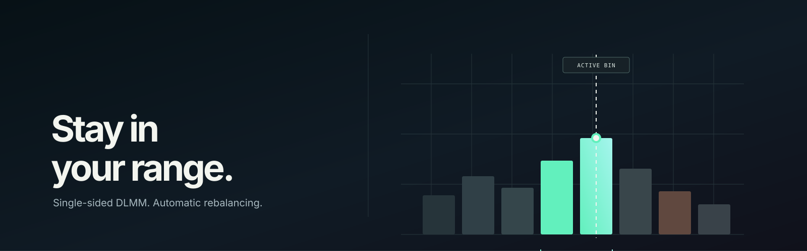

<p align="center">
  
</p>

<p align="center">
  
  
  
  
  
</p>

# DLMM tight-range bot

This bot manages one Meteora DLMM pool. It opens a position that spans one or two
bins around the active bin. When the price moves outside the range, it closes the
position, claims fees, and opens a new single-sided position. If the wallet holds
both pool tokens, the bot deposits only the side with the greater value at the
active-bin price. The other token stays in the wallet.

This bot can trade real funds. Read the risk notes before enabling `LIVE`.

## One cycle

```text
main() [1] ← one pool, one wallet
├── observe(chain) [1a] ← read current chain state
│   ├── pool.refetchStates() [1a1]
│   ├── getPositionsByUserAndLbPair(owner) [1a2] ← positions and active bin
│   ├── wallet: SOL, tokenX, tokenY [1a3]
│   └── depositsEnabled [1a4]
├── decide(snapshot, policy, history) [1b] ← pure function, no I/O
│   ├── stale snapshot [1b1]
│   │   └── Halt "stale-chain" [1b1a]
│   ├── duplicate positions [1b2]
│   │   └── Close all but the position nearest the active bin [1b2a]
│   ├── one position [1b3]
│   │   ├── outside range [1b3a]
│   │   │   └── Rebalance [1b3a1]
│   │   └── inside range [1b3b]
│   │       └── Idle "in-range" [1b3b1]
│   └── no position [1b4]
│       ├── check SOL reserve, inventory, deposit status, cooldown, and dwell [1b4a]
│       └── Open one side in a range selected for token X or Y [1b4b]
├── act(ctx, decision) [1c]
│   ├── Open [1c1]
│   │   ├── generate a position keypair [1c1a]
│   │   ├── initializePositionAndAddLiquidityByStrategy(...) [1c1b]
│   │   └── simulate, sign, send, and confirm [1c1c]
│   ├── Rebalance [1c2]
│   │   ├── remove liquidity, claim fees, and close [1c2a]
│   │   ├── observe again after close confirms [1c2b]
│   │   └── open from the updated wallet balances [1c2c]
│   └── Close [1c3]
│       └── use the same close path [1c3a]
└── write journal and sleep for pollIntervalMs [1d]
```

`decide` does not keep state. The chain is the source of truth. If the process stops
during a rebalance, the next cycle reads the actual position and continues from there.

## How the bin range works

Bins below the active bin hold token Y. Bins above it hold token X. A position at the
active bin can hold token Y by default. The `singleSidedX` strategy option handles an
X-only position at the active bin.

- A one-bin Y position uses `[a, a]`.
- A two-bin Y position uses `[a-1, a]`.
- A two-bin X position uses `[a, a+1]`.
- If the wallet holds both tokens, the bot compares their value at the active-bin
  price and deposits only the more valuable side. It leaves the other token in the wallet.

The bot does not swap through Jupiter. It uses the selected token balance already in
the wallet, so it does not force a swap when the price crosses the range.

For a pool with wrapped SOL on one side, the bot counts native SOL above
`MIN_SOL_RESERVE_SOL` as available balance on that side. Meteora's SDK wraps SOL during
the open transaction and unwraps it when the position closes.

## Safety

- `DRY_RUN=true` is the default. The bot builds and simulates transactions but does
  not send them.
- Live trading requires `LIVE=true`, `DRY_RUN=false`, and the `--confirm-live` flag.
- The bot simulates every transaction before sending it. A failed simulation stops that
  transaction from being sent.
- `MAX_REBALANCES_PER_HOUR` is currently checked only when no position is open. It does
  not limit repeated rebalances while a position is open.
- `MIN_REBALANCE_INTERVAL_MS` is also checked only when no position is open.
- `MIN_SOL_RESERVE_SOL` prevents new positions when the wallet is below the reserve.
  It does not stop management of an open position. Keep extra SOL for position and bin
  array rent, which the open transaction pays.
- `DWELL_TICKS` waits for the active bin to remain unchanged for several polling cycles
  before opening.
- `MAX_DEPLOY_X` and `MAX_DEPLOY_Y` cap the raw token amounts considered for a deposit.
- The bot writes decisions and transaction results to `state/journal.jsonl`.

`MAX_SNAPSHOT_AGE_MS` does not detect a slow RPC response reliably. The snapshot
timestamp is set after the chain reads finish, so a delayed response can still look fresh.

## Run the bot

Install Bun 1.2 or later.

```bash
bun install
cp .env.example .env
# Set RPC_URL, POOL_ADDRESS, and the wallet path.

bun run probe                  # Read the pool without a funded wallet.
bun run once                   # Run one cycle in dry-run mode.
bun run dev                    # Run the loop in dry-run mode.
bun src/main.ts --confirm-live # Run the live loop with the safety gate.
```

Set `WALLET_KEYPAIR_PATH` to a file containing a JSON secret-key array or a base58
private key exported from Phantom or Backpack. Both formats also work with
`WALLET_SECRET_KEY`. Use a dedicated bot wallet because the bot can deploy its selected
token balance.

Environment variables can expose private keys through shell history, `docker inspect`,
or process logs. For live funds, use `WALLET_KEYPAIR_PATH` and restrict file access to
the bot user.

`bun run probe` only needs an RPC URL. Other modes build transactions and need a wallet
with SOL for fees and rent. Dry-run does not remove that requirement.

## Environment variables

| Variable | Default | Description |
| --- | --- | --- |
| `RPC_URL` | `https://api.mainnet-beta.solana.com` | HTTP RPC. Public RPC may be too slow for a tight range. |
| `WS_URL` | Derived from `RPC_URL` | Reserved for future use. The polling loop does not use it. |
| `POOL_ADDRESS` | Required | DLMM pool address. |
| `WALLET_KEYPAIR_PATH` | Required unless `WALLET_SECRET_KEY` is set | JSON array or base58 key file. |
| `WALLET_SECRET_KEY` | Empty | Alternative to a key file. Accepts a 64-byte base58 key, 32-byte base58 seed, or JSON array. |
| `POSITION_WIDTH` | `1` | Position width in bins. Accepted values are `1` and `2`. |
| `SLIPPAGE_PERCENT` | `1` | Percent, not basis points. The SDK converts it to a bin tolerance. |
| `MAX_DEPLOY_X`, `MAX_DEPLOY_Y` | No limit | Maximum raw token amount considered for a deposit. |
| `MIN_SOL_RESERVE_SOL` | `0.05` | SOL reserved for fees and rent. |
| `PRIORITY_FEE_MICRO_LAMPORTS` | `50000` | Priority fee per compute unit. |
| `MAX_PRIORITY_FEE_MICRO_LAMPORTS` | `2000000` | Maximum priority fee per compute unit. |
| `POLL_INTERVAL_MS` | `4000` | Delay between polling cycles. |
| `DWELL_TICKS` | `2` | Consecutive cycles with the same active bin required before opening. |
| `MAX_REBALANCES_PER_HOUR` | `20` | Rebalance limit checked while the wallet has no position. |
| `MIN_REBALANCE_INTERVAL_MS` | `60000` | Minimum delay before opening while the wallet has no position. |
| `MAX_SNAPSHOT_AGE_MS` | `30000` | Maximum snapshot age checked by the decision logic. |
| `STATE_DIR` | `./state` | Journal and HALT file directory. |
| `LOG_LEVEL` | `info` | Accepted values are `debug`, `info`, `warn`, and `error`. |
| `DRY_RUN` | `true` | Simulate transactions without sending them. |
| `LIVE` | `false` | Must be `true` with `DRY_RUN=false` for live trading. |

## Costs

Each rebalance can pay network fees for its close and open transactions. Other costs
include:

- A composition fee when a deposit changes the composition of a non-empty active bin.
- About `0.0714 SOL` in rent for each new bin array. The pool owns the array, and the
  rent is not returned when your position closes.
- Position account rent, which returns when the position closes.

Helius charges by plan and credit usage. Check the [current Helius pricing](https://www.helius.dev/pricing)
before budgeting. This bot polls the RPC, so usage follows the number of polling cycles.
It does not use WebSocket streaming.

## Verification

Verified locally:

- `bunx tsc --noEmit` passes.
- `bun run test` passes 47 tests covering decisions, config parsing, wallet parsing, and bin math.
- `bun run probe` on the mainnet SOL/USDC pool `5rCf1DM8LjKTw4YqhnoLcngyZYeNnQqztScTogYHAS6`
  returns the active bin, bin step 4, token decimals, and `depositsEnabled: true`.
- `bun scripts/selfcheck.ts` builds a one-bin open transaction with the expected DLMM program.
- `bun src/main.ts --once` on an empty wallet halts with `sol-reserve`. With
  `MIN_SOL_RESERVE_SOL=0`, it idles with `no-inventory` and exits successfully.
- A dry-run on a wallet with `0.5 SOL` and a `TOKEN/SOL` pool chose a `0.3 SOL` deposit.
  The Meteora SDK wrapped native SOL in the simulated open transaction.

Live transaction submission, close-and-claim behavior, and a full live rebalance have
not been verified end to end. Run a dry-run with a small funded wallet first. A
successful simulation proves that the transaction can execute with the observed state.

## Limitations

- One pool, one wallet, and one process. There is no multi-pool mode.
- The bot polls instead of using WebSockets. Reaction time follows `POLL_INTERVAL_MS`.
  A one-bin range needs a fast, reliable RPC.
- The bot does not swap tokens. It does not convert back to token Y after the price
  crosses the range.
- The bot does not calculate profit automatically. `state/journal.jsonl` records events
  that can be used for a later PnL calculation.
